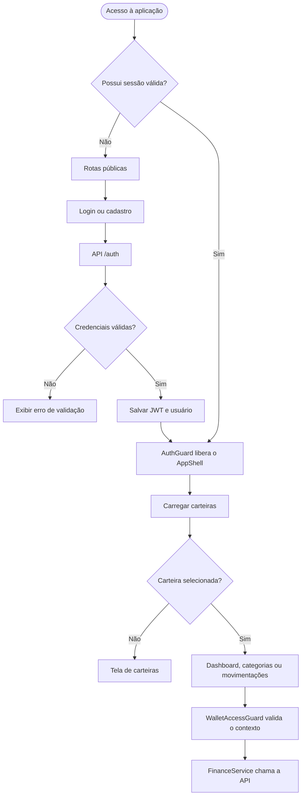
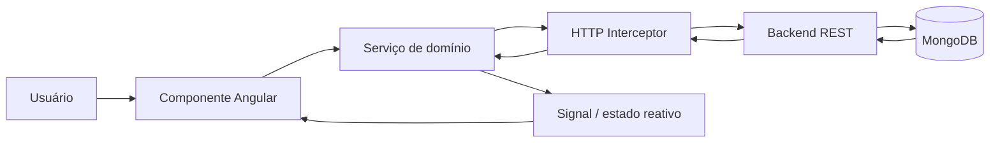

# Finan$e — Frontend

> Interface web do sistema de controle financeiro pessoal, desenvolvida para organizar carteiras, categorias e movimentações em uma experiência simples, responsiva e orientada a dados.

[](https://angular.dev/)
[](https://www.typescriptlang.org/)
[](https://primeng.org/)

## Visão geral

O frontend consome a API REST do [backend](../backend/README.md) e oferece:

- autenticação, cadastro e recuperação de senha;
- gerenciamento de múltiplas carteiras;
- categorias padrão e categorias personalizadas por tipo;
- cadastro, edição, exclusão e consulta de receitas e despesas;
- histórico paginado com busca, filtros e ordenação;
- dashboard com indicadores, comparativos, destaques e gráficos;
- proteção de rotas e persistência da sessão do usuário.

## Stack e decisões técnicas

| Tecnologia | Uso |
| --- | --- |
| Angular 21 | Framework da aplicação e roteamento |
| TypeScript 5.9 | Tipagem estática e organização do código |
| PrimeNG 21 + PrimeIcons | Componentes de interface, diálogos, tabelas e feedbacks |
| Chart.js | Gráficos do dashboard |
| RxJS | Comunicação HTTP e composição assíncrona |
| Signals | Estado reativo local dos serviços e componentes |
| SCSS | Estilos e tema visual |

## Pré-requisitos

- Node.js 20 ou superior;
- npm 10 ou superior;
- backend executando em `http://localhost:3000/api`.

## Instalação e execução

```bash
npm install
npm start
```

A aplicação estará disponível em <http://localhost:4200>.

Para apontar para outra API, altere `apiUrl` em [environment.ts](src/environments/environment.ts). O build de produção gera o ambiente a partir das variáveis configuradas no projeto.

## Scripts disponíveis

| Comando | Descrição |
| --- | --- |
| `npm start` | Inicia o servidor de desenvolvimento |
| `npm run build` | Gera o bundle otimizado de produção |
| `npm test` | Executa os testes unitários via Angular/Karma |

## Arquitetura da aplicação

```text
src/app/
├── core/
│   ├── guards/          authGuard, guestGuard e walletAccessGuard
│   ├── interceptors/    inclusão do token JWT nas requisições
│   └── services/        AuthService e FinanceService
├── features/
│   ├── auth/            login, cadastro e recuperação de senha
│   ├── categories/      listagem e diálogo de categorias
│   └── movements/       carteiras, movimentações e dashboard
├── layout/              shell, navegação e estrutura visual
├── models/              contratos de autenticação e finanças
└── app.routes.ts        rotas públicas e protegidas
```

### Estado e sessão

- `AuthService` mantém usuário, token e estado de autenticação com Signals.
- O JWT e os dados básicos do usuário são armazenados no `localStorage`.
- A carteira selecionada é mantida no `sessionStorage`, evitando misturar o contexto entre sessões.
- `FinanceService` centraliza carteiras, categorias, movimentações e dashboard.
- O carregamento de carteiras é compartilhado para evitar requisições duplicadas.

## Fluxo de navegação e autenticação



## Fluxo de dados da aplicação



### Funcionalidades por tela

| Rota | Funcionalidade |
| --- | --- |
| `/login` | Entrada do usuário |
| `/cadastro` | Criação de conta |
| `/esqueci-senha` | Solicitação de recuperação por e-mail |
| `/redefinir-senha` | Definição de nova senha |
| `/carteiras` | Seleção e gerenciamento de carteiras |
| `/dashboard` | Indicadores e gráficos da carteira ativa |
| `/movimentacoes` | Histórico paginado e filtros |
| `/movimentacoes/nova` | Cadastro de receita ou despesa |
| `/movimentacoes/:id/editar` | Edição de movimentação |
| `/categorias` | Gerenciamento de categorias |

## Dashboard

O dashboard consome `GET /api/wallets/:walletId/dashboard` e apresenta:

- total de receitas, despesas, saldo e ticket médio;
- maior receita e maior despesa do período;
- comparação com o período anterior equivalente;
- distribuição de despesas por categoria;
- evolução diária de receitas e despesas;
- as dez movimentações mais recentes.

O detalhamento do tratamento e do contrato de resposta está em [fluxo-e-tratamento-de-dados-do-dashboard.md](../fluxo-e-tratamento-de-dados-do-dashboard.md).

## Entregas acadêmicas

### AC1 — Cadastro de movimentações ✅

Layout principal, carteiras, categorias, formulário reativo, receitas, despesas e integração HTTP.

### AC2 — Histórico de movimentações ✅

Listagem paginada, busca por descrição, filtros por tipo/categoria/período, ordenação, edição e exclusão.

### AC3 — Dashboard financeiro ✅

Resumo financeiro, gráficos, comparativo histórico, filtros de período/categoria, destaques e últimas movimentações.

### Evolução de autenticação ✅

Login, cadastro, JWT, guards, interceptor, perfil, alteração de senha e recuperação de senha via e-mail.

## Boas práticas para contribuição

1. Mantenha componentes focados em apresentação e delegue regras de negócio aos serviços.
2. Reutilize os modelos em `src/app/models` para preservar o contrato com a API.
3. Ao criar uma rota protegida, avalie `authGuard` e `walletAccessGuard`.
4. Execute `npm run build` antes de abrir uma entrega.
5. Nunca versione credenciais ou tokens no repositório.

## Documentação relacionada

- [Backend e API](https://github.com/MichelDeziderio/finance-backend/blob/main/README.md)
